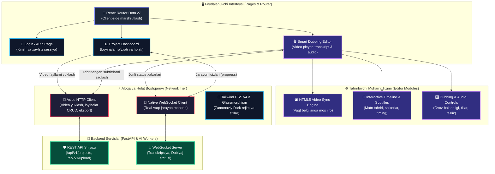

# 🎬 AI Dub Studio — Frontend

[](https://reactjs.org/)
[](https://vitejs.dev/)
[](https://tailwindcss.com/)
[](https://www.typescriptlang.org/)

**AI Dub Studio** — bu sun'iy intellekt yordamida videolarni avtomatik tarjima qilish va dublyaj qilish uchun mo'ljallangan zamonaviy web-platformaning frontend qismi. Ushbu loyiha foydalanuvchilarga videolarni yuklash, ularni qayta ishlash jarayonini real-vaqtda kuzatish va tayyor natijani tahrirlash imkonini beradi.

---

## ✨ Asosiy Imkoniyatlar

- **📊 Professional Dashboard**: Loyihalarni boshqarish uchun sodda va qulay interfeys.
- **⚡ Real-vaqt Progress**: `WebSockets` orqali videoga ishlov berish jarayonini (transkripsiyadan tortib dublyajgacha) jonli kuzatish.
- **🎨 Modern Dizayn**: TailwindCSS v4 va Glassmorphism effektlari asosida yaratilgan, ko'zga yoqimli "Dark Mode" interfeysi.
- **📽️ Smart Editor**: AI tomonidan yaratilgan transkripsiyani tahrirlash, vaqt belgilarini (timestamps) moslash va tarjimani tasdiqlash uchun maxsus muharrir.
- **📱 Responsive Layout**: Har qanday qurilma (desktop, planshet, mobil) uchun to'liq moslashgan dizayn.

---

## 🛠 Texnologik Stack

- **Framework**: [React 19](https://reactjs.org/) + [TypeScript](https://www.typescriptlang.org/)
- **Build Tool**: [Vite 6](https://vitejs.dev/)
- **Styling**: [TailwindCSS v4](https://tailwindcss.com/) (Eng so'nggi versiya)
- **State & API**: 
  - `Axios` (Server bilan ma'lumot almashish)
  - `Native WebSockets` (Real-vaqtda status olish)
- **Routing**: `React Router Dom v7`

---

## 🏛️ Frontend Arxitekturasi (System Architecture)

**AI Dub Studio** frontend arxitekturasi modulli sahifalar, video-pleyer va subtitrlar vaqtini real-vaqtda sinxronlovchi muharrir hamda `WebSockets` orqali uzluksiz status almashuvchi tarmoq qatlami asosida ishlaydi:



### 🔄 Real-Vaqt Video Qayta Ishlash Oqimi (Pipeline Flow)
1. **Loyiha Yaratish:** Foydalanuvchi video yuklaydi $\rightarrow$ `Axios` orqali backendga uzatiladi va unikal loyiha ID raqami olinadi.
2. **Jonli Kuzatuv (WebSocket):** Frontend WebSocket orqali ulanadi va transkripsiyalash, matn tarjimasi va dublyaj yaratilish foizlarini progress-barda ko'rsatib boradi.
3. **Smart Editor Sinxronizatsiyasi:** Natija tayyor bo'lgach, foydalanuvchi muharrirga o'tadi — videoning har bir soniyasiga mos keluvchi subtitrlar bloklari jonli faollashadi, foydalanuvchi o'zgartirish kiritishi va yangi dublyajni tinglashi mumkin.

---

## 🚀 Loyal Muhitda Ishga Tushirish

Loyihani o'z kompyuteringizda yurgizish uchun quyidagi qadamlarni bajaring:

```bash
# 1. Repozitoriyani klonlash
git clone https://github.com/Farhodoff/video-translate-front.git

# 2. Loyiha papkasiga kirish
cd video-translate-front

# 3. Kutubxonalarni o'rnatish
npm install

# 4. Dev-serverni ishga tushirish
npm run dev
```
Odatda ilova **[http://localhost:5173](http://localhost:5173)** manzilida ishga tushadi.

---

## 📁 Loyiha Strukturasi

```text
src/
├── api/          # Server bilan bog'lanish va API konfiguratsiyasi
├── assets/       # Rasm, ikonka va boshqa statik fayllar
├── components/   # Qayta ishlatiluvchi UI komponentlar (buttons, inputs, cards)
├── pages/        # Asosiy sahifalar (Dashboard, Login, Editor)
└── App.tsx       # Routing va ilovaning kirish nuqtasi
```

---

## 👤 Muallif

**[Farhodoff](https://github.com/Farhodoff)** — Full-stack Developer.

---

## 📜 Litsenziya

MIT License. Loyihadan shaxsiy yoki tijoriy maqsadlarda foydalanishingiz mumkin.
